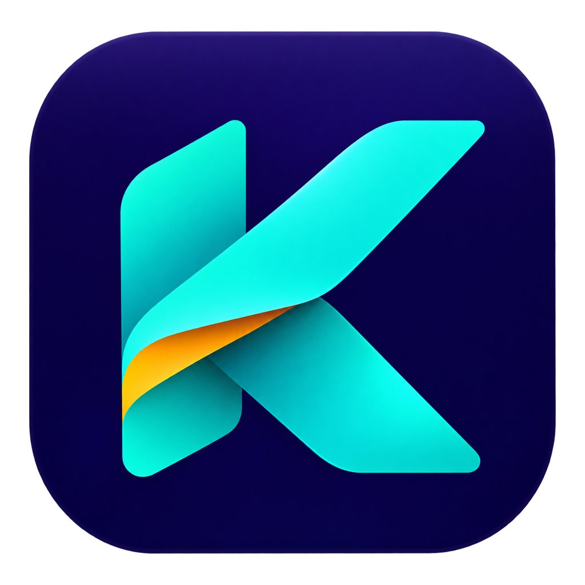

<!--
# SPDX-FileCopyrightText: Copyright 2025 Eden Emulator Project
# SPDX-License-Identifier: GPL-3.0-or-later

# SPDX-FileCopyrightText: 2018 yuzu Emulator Project
# SPDX-License-Identifier: GPL-2.0-or-later
-->

<p align="center">
  
</p>

<h1 align="center">Kaichii</h1>

<p align="center">
  <b>A Switch 2 emulator for the computers people actually have.</b><br>
  <i>kai (改): to renew, to change for the better</i>
</p>

Kaichii is JavocSoft's fork of [Lichii](https://github.com/zortos293/Lichii), an experimental,
open-source Nintendo Switch and Switch 2 emulator written in C++. Lichii and the projects before it
taught Switch 2 games to boot. Kaichii works on the next step: making them playable on an ordinary
laptop with a 4 GB graphics card, and making the emulator understandable to a player who has never
had to think about shaders or video memory.

The name says what it is about. *Kai* (改) is Japanese for renewing or changing something: Kaichii
keeps what Lichii built and reworks what stood between a regular player and their game.

> [!NOTE]
> Kaichii is not affiliated with Nintendo. Games, keys and firmware are not included: use only games
> and system files you have legally obtained.

## What Kaichii focuses on

### Playable on modest hardware

Kaichii is developed and measured on a laptop with an RTX 3050 (4 GB of video memory).

- **Settings picked from your computer.** *Configure > Performance* measures the graphics card, the
  free video memory and the processor, and recommends one of four presets: Performance, Balanced,
  Quality or Ultra.
- **Optimize for This Game.** In a game's right-click menu: Kaichii measures the game where it is
  played and proposes the settings that suit it.
- **Built for 4 GB cards.** Textures can be decoded on the processor, the texture cache stops a
  runaway before it fills the card, and when video memory does run out Kaichii retries or leaves an
  image out instead of crashing.
- **Fewer shader stutters.** New Switch 2 pipelines are translated in the background while the game
  keeps running, and the shaders of earlier sessions are prepared before they are needed.
- **PGO builds**, compiled with profiles recorded while playing.

On that laptop, the hardware presets, texture decoding on the processor and stall-free reads took
Ocarina of Time from 14 to 42 fps ([#9](https://github.com/javocsoft/Kaichii/pull/9)). Results vary
with the game, the hardware and the driver.

### Settings anyone can follow

- **Every option explains itself.** A help panel under the settings says what the option under the
  pointer does, what it costs, and what is recommended for this computer.
- **Organized by what they are for:** Performance, Image, Smoothness and shaders, Audio, Controls,
  System and Interface. A basic view shows what most players need; advanced and developer options
  are one switch away, and a search finds any of them.
- **Per-game settings at a glance.** A game's configuration opens on a summary of what that game
  changes from the global settings, with a button to undo each change.
- **A setup assistant** for new installations: your games folder, a preset for this computer, the
  console mode and the controllers.
- **In Spanish**, Qt's own buttons and dialogs included.

### Careful fixes

- Fixes come from reviewing Lichii and Eglantine first, merged and open pull requests alike, and are
  ported with credit to where they came from.
- Every change in behaviour ships with a test. Sanitizers and four required checks run on every pull
  request.
- A shader Kaichii can't translate is rejected and logged, never guessed.

### Linux as a first-class platform

- A self-contained AppImage, with a PGO build.
- Dialogs that fit on Wayland desktops, PipeWire audio without crackle, and NVIDIA's shader cache
  kept between sessions.

## Download

Builds are on the [releases page](https://github.com/javocsoft/Kaichii/releases). The PGO builds are
recommended.

| System | File | How to run it |
|---|---|---|
| Linux (x86-64) | `kaichii-linux-x86_64-pgo.AppImage` | Make it executable (`chmod +x`) and run it. Needs glibc 2.39 or newer: Ubuntu 24.04, Fedora 40, Debian 13, Arch |
| Windows (x86-64) | `kaichii-windows-x86_64-pgo.zip` | Extract the whole folder and run `kaichii.exe` |
| macOS (Apple Silicon) | `kaichii-macos-arm64.zip` | Not notarized: right-click the app and choose *Open* the first time |

Kaichii checks this repository's releases for updates and offers to install them.

### Coming from Lichii

Kaichii uses the same data folder (`eden`), so it finds your saves, settings and shader caches as
they are. A build still named Lichii won't update itself to Kaichii: download Kaichii once by hand.

## Telling how a game runs

After playing a Switch 2 game, stop it, right-click it and choose **Submit compatibility report**.
Kaichii fills in your system and settings; you add how it went. **Open on GitHub** shows the report
on a new issue here, where you review it and publish it with your GitHub account. Kaichii sends
nothing by itself. Published reports are under the
[compatibility label](https://github.com/javocsoft/Kaichii/issues?q=label%3Acompatibility).

## Reporting a problem

Open an [issue](https://github.com/javocsoft/Kaichii/issues) and include:

- The build (the first line of the log, `Kaichii Version: ...`), the game and its version, and your
  processor, graphics card and driver version.
- What you did, what happened and what you expected. A screenshot helps.
- The log of that session: *File > Open Kaichii Folders > Log Folder*, file `eden_log.txt`. Check it
  for personal information first.

Never upload games, keys, firmware or account details.

## Building and contributing

On any Linux machine with Docker:

```sh
tools/dev/in-docker.sh tools/dev/build-tests.sh       # build, and run every C++ test
```

The [build guide](docs/Build.md) covers native builds on each platform, and
[docs/ai](docs/ai/README.md) explains how the code is organized, how it is tested and how fixes from
upstream are ported. Read the [coding guidelines](docs/Coding.md) before opening a pull request.

Some names from earlier projects stay on purpose: the `eden` data folder and the `EDEN_*` switches
(they keep your saves and settings), the `eden-cli` command-line program and the `yuzu` build target.

## Artwork

The Kaichii logo is by JavocSoft. The program icons are generated from
[dist/branding/kaichii_icon.png](dist/branding/kaichii_icon.png) by
[tools/generate_icons.py](tools/generate_icons.py).

## Credits and license

Kaichii is a fork of [Lichii](https://github.com/zortos293/Lichii) by zortos293 and its
contributors, which builds on [Eglantine](https://github.com/Djihads80/Eglantine) (originally by
Camille LaVey), Eden, yuzu, Sudachi and Citra. Nearly everything Kaichii can do, it owes to them.
Fixes ported from those projects name their origin in the commit and pull request that brought them.

Kaichii's own changes are by JavocSoft. Original copyright notices and third-party licenses are kept;
see [LICENSE.txt](LICENSE.txt) and the source files for the terms that apply.
